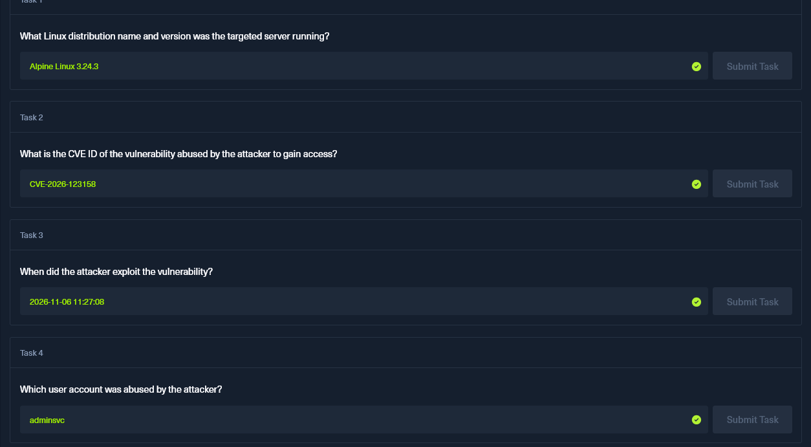
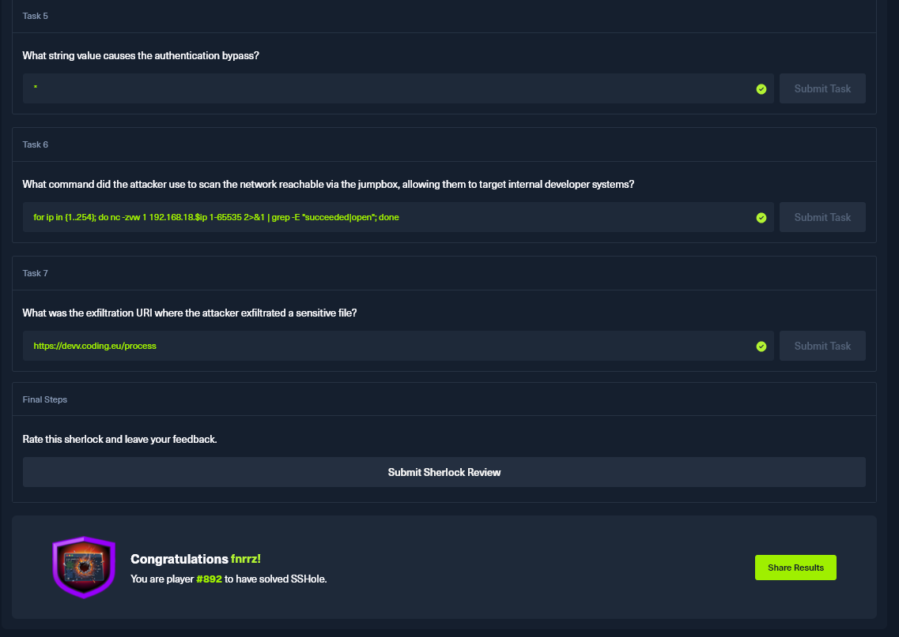

# Informe Técnico de Vulnerabilidad y Análisis Forense: `sshole` (CVE-2026-123158)

**Autor:** Oscar Muñoz Carvajal
**Fecha:** 18 de Noviembre de 2026  
**Asignatura:** Diseño de Arquitecturas Seguras TI  
**Entorno de Evaluación:** Laboratorio Forense Sherlock (`sshole`)

---

## 1. Introducción al Problema

La vulnerabilidad **sshole (CVE-2026-123158)** representa un fallo crítico de elusión (*bypass*) de autenticación en el demonio **OpenSSH (`sshd`)** cuando opera sobre sistemas Linux ligeros basados en **`musl libc`** (como Alpine Linux) sin el uso de módulos **PAM** (*Pluggable Authentication Modules*).

El problema surge de una colisión lógica al procesar contraseñas de gran longitud (superiores a 256 caracteres): la función `crypt()` implementada en `musl` devuelve un código de error estandarizado (`*`) al rechazar la longitud de la cadena. Dicho retorno colisiona directamente con el marcador utilizado en `/etc/shadow` para cuentas bloqueadas o deshabilitadas, permitiendo que un atacante eluda la validación de credenciales y obtenga acceso interactivo no autorizado a través del puerto SSH.

---

## 2. Desarrollo de Preguntas Teóricas

### 2.1. Arquitectura y Dependencias

**Combinación de componentes estrictamente vulnerable:**  
Para que un entorno sea susceptible a `sshole`, deben coexistir simultáneamente tres condiciones a nivel de sistema operativo y servicios de red:

1. **Librería estándar de C (`musl libc`):** Presente habitualmente en distribuciones minimalistas orientadas a contenedores (como Alpine Linux) por su bajo consumo de recursos.
2. **Demonio OpenSSH (`sshd`) compilado o configurado sin soporte PAM (`UsePAM no`):** Al prescindir de un gestor de autenticación modular, el demonio valida las contraseñas invocando directamente las funciones criptográficas nativas de la librería C del sistema contra `/etc/shadow`.
3. **Cuentas locales bloqueadas o sin contraseña asignada:** Usuarios del sistema o cuentas de servicio cuyo campo de *hash* en `/etc/shadow` contiene el carácter literal `*` (y cuyo acceso por contraseña no ha sido deshabilitado en `sshd_config`).

**¿Por qué los sistemas tradicionales basados en `glibc` con soporte PAM están exentos?**

* **Comportamiento de `glibc`:** En distribuciones tradicionales (como Debian, Ubuntu o RHEL), la implementación de `crypt()` en `glibc` (o `libcrypt`) retorna un puntero nulo (`NULL`) o un indicador de error distinto de `*` ante entradas inválidas o longitudes no soportadas. El demonio `sshd` interpreta el retorno nulo como un fallo inmediato y aborta el proceso antes de comparar cadenas.
* **Capa de aislamiento mediante PAM:** Cuando `UsePAM yes` está habilitado, `sshd` delega la validación de identidad a la pila modular de PAM (por ejemplo, `pam_unix.so`). PAM realiza comprobaciones previas sobre el estado administrativo de la cuenta y valida la longitud máxima del búfer antes de evaluar el *hash*, impidiendo que un código de error sea interpretado como una coincidencia válida.

---

### 2.2. Mecánica de la Colisión

El falso positivo de autenticación se produce a través de la siguiente secuencia de interacciones entre OpenSSH, el *salt* criptográfico y `musl libc`:

1. **Envío de una contraseña sobredimensionada:** Durante la fase de autenticación SSH por contraseña, el cliente envía una cadena de texto cuya longitud supera los 256 caracteres.
2. **Lectura del *salt* en OpenSSH:** Al operar sin PAM, `sshd` consulta el registro del usuario objetivo en `/etc/shadow`. Toma el valor almacenado en el campo de *hash* —que en una cuenta bloqueada o deshabilitada corresponde al carácter `*`— y lo pasa como parámetro *salt* a la llamada `crypt(password_ingresada, salt)`.
3. **Manejo de errores en `crypt()` de `musl`:** La implementación de `crypt()` en `musl` detecta que la contraseña excede el límite soportado de 256 bytes. En lugar de devolver `NULL`, su rutina de manejo de errores devuelve una cadena literal de fallo estandarizada: `"*"`.
4. **Colisión y falso positivo:** Finalmente, `sshd` compara el resultado devuelto por `crypt()` contra el valor guardado en `/etc/shadow` mediante una comparación directa de cadenas. Al coincidir el código de error devuelto (`"*"`) con el marcador de cuenta bloqueada (`"*"`), la validación resulta verdadera (`"*" == "*"`), otorgando acceso autenticado sin conocer ninguna credencial legítima.

---

### 2.3. Mitigación y Endurecimiento (*Hardening*)

Además de aplicar el parche oficial de actualización de OpenSSH y/o `musl libc`, se deben instrumentar controles de defensa en profundidad en `/etc/ssh/sshd_config` y a nivel de arquitectura para reducir drásticamente la superficie de exposición:

#### Medida 1: Deshabilitar la autenticación por contraseña (Uso exclusivo de claves asimétricas)
Al desactivar por completo el inicio de sesión mediante contraseña y forzar el uso de criptografía de clave pública, el flujo de ejecución de `sshd` nunca invoca la función `crypt()`, eliminando el vector de ataque de raíz.

~~~text
# En /etc/ssh/sshd_config
PasswordAuthentication no
KbdInteractiveAuthentication no
ChallengeResponseAuthentication no
PubkeyAuthentication yes
~~~

#### Medida 2: Control estricto de cuentas autorizadas y bloqueo de `root`
Restringir explícitamente qué usuarios o grupos pueden iniciar sesión por SSH y bloquear el acceso directo al superusuario evita que cuentas de servicio o cuentas bloqueadas (portadoras del marcador `*` en `/etc/shadow`) puedan ser alcanzadas a través de la red.

~~~text
# En /etc/ssh/sshd_config
PermitRootLogin no
AllowUsers operador_sec
MaxAuthTries 3
~~~

#### Medida 3 (Complementaria de Arquitectura): Aislamiento de red e inmutabilidad en contenedores
En entornos contenerizados basados en Alpine Linux, se debe evitar ejecutar demonios `sshd` dentro de los contenedores, gestionándolos mediante el orquestador (`docker exec` / `kubectl exec`). En servidores donde SSH sea estrictamente necesario, el puerto 22 debe aislarse de Internet mediante listas de control de acceso (ACL/Security Groups), permitiendo el tráfico únicamente desde una VPN corporativa o un *Bastion Host* con MFA.

*(Nota: Tras aplicar cambios en `/etc/ssh/sshd_config`, se debe validar la sintaxis con `sshd -t` y recargar el servicio).*

---

### 3.1. Resumen de Evidencia Analizada
* **Servidor y Sistema Operativo afectado:** `dev-jumpbox` — Alpine Linux 3.24.3
* **Artefactos inspeccionados:** `/var/log/messages`, `/etc/os-release`, `/etc/shadow` e historial de comandos de la shell (`.ash_history`).
* **Vulnerabilidad explotada:** `CVE-2026-123158` (valor de colisión: `*`).
* **IP de origen del atacante:** `192.168.72.1` (puerto origen `61351`).
* **Usuario objetivo comprometido:** `adminsvc`.
* **Línea de tiempo del acceso:**
  * `2026-11-06 11:27:05`: Intento fallido de autenticación SSH (`Failed password for adminsvc`).
  * `2026-11-06 11:27:08`: Explotación exitosa y acceso concedido (`Accepted password for adminsvc`).
  * `2026-11-06 12:20:02`: Cierre de sesión del atacante (`Disconnected from user adminsvc`).
* **Actividad post-explotación (Escaneo de red interna):**
  El atacante utilizó el *jumpbox* como pivote para enumerar puertos abiertos en la subred interna de desarrolladores (`192.168.18.1` a `192.168.18.254`) mediante el siguiente comando:
  ```bash
  for ip in {1..254}; do nc -zvw 1 192.168.18.$ip 1-65535 2>&1 | grep -E "succeeded|open"; done
  ```
* **Exfiltración de datos:** El archivo sensible fue exfiltrada hacia la URI `[https://devv.coding.eu/process](https://devv.coding.eu/process)`.

### 3.2. Evidencia del Resultado (Laboratorio Completado)
A continuación se adjuntan las capturas que validan la resolución completa de las tareas forenses del reto Sherlock `sshole`:





---

## 4. Conclusión

El análisis de `sshole` (CVE-2026-123158) evidencia cómo decisiones de diseño orientadas a la ligereza —como el uso de `musl libc` sin PAM en contenedores— pueden introducir comportamientos inesperados al interactuar con servicios críticos como OpenSSH. La aplicación combinada de gestión oportuna de parches, endurecimiento de configuraciones (eliminación de contraseñas y listas blancas de usuarios), segmentación de red y monitoreo centralizado de logs constituye la base para prevenir y detectar oportunamente este tipo de compromisos.
